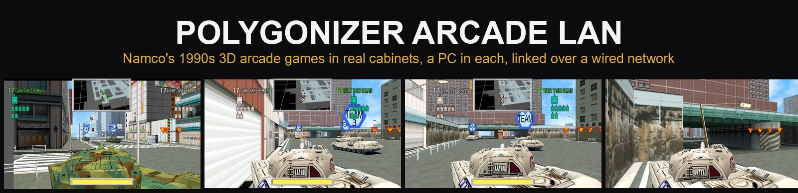
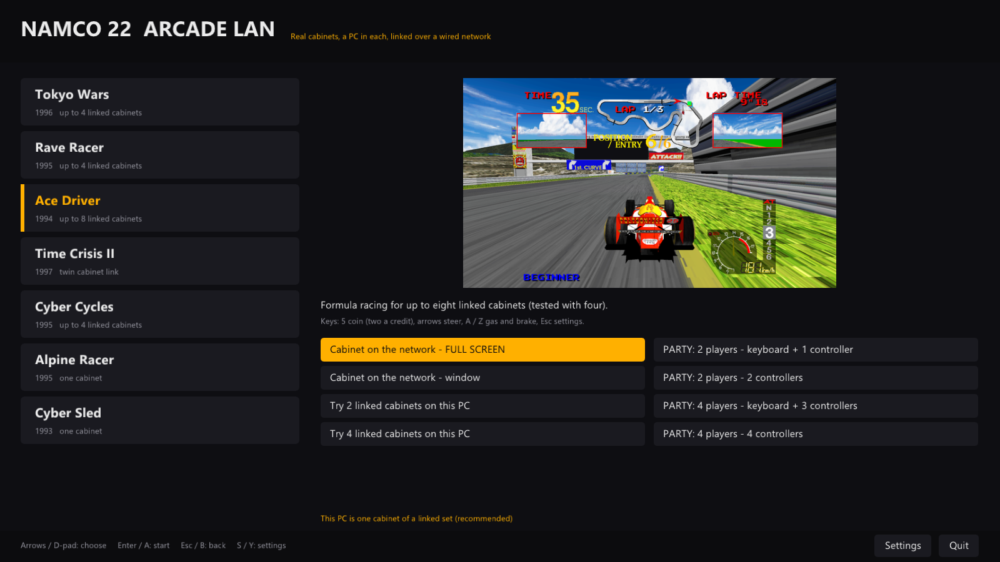
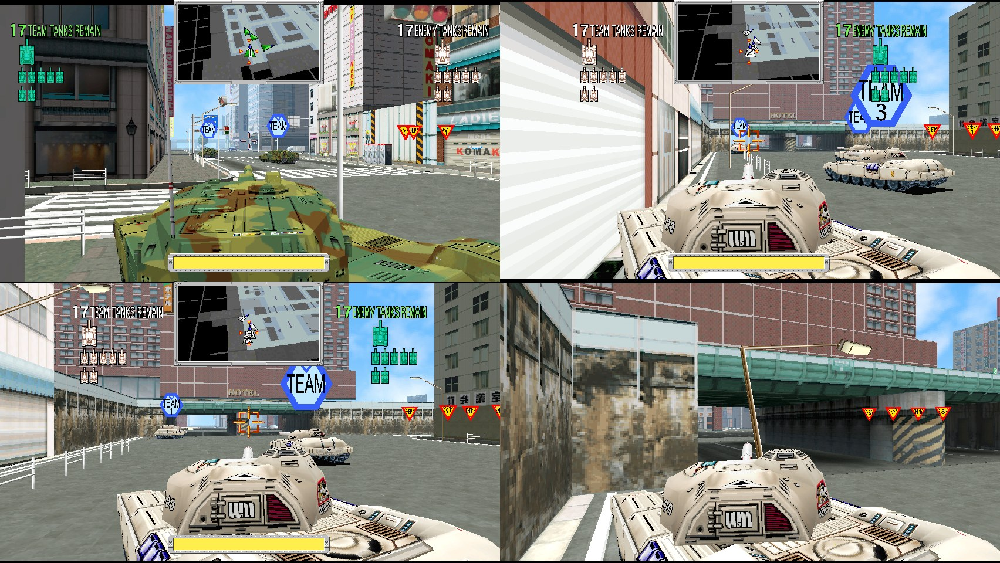

<p align="center">
  
</p>

# Namco 22: Arcade LAN

**A fork of [namco22-decompile](https://github.com/spacestate1/namco22-decompile) by
[spacestate1](https://github.com/spacestate1), made to keep real arcade cabinets running.**

namco22-decompile rebuilds Namco's 1990s arcade games (System 21, 22 and 23) so they run natively on a PC. All of that
work is spacestate1's. This fork puts those games into real cabinets: a PC in place of the original boards, the
cabinets linked over a wired network the way the boards were linked by their cable, starting by themselves when the
cabinet is switched on. Huge respect and thanks to spacestate1; please star and support
[the original project](https://github.com/spacestate1/namco22-decompile), and use it for playing at home or online.

**You need your own copy of the games.** This repository contains no ROMs or game data.

## Why this exists

This project was made for an arcade that runs Tokyo Wars, Rave Racer, Cyber Cycles, Prop Cycle and Time
Crisis II cabinets. Their original hardware has been problematic over the years, and the aim is a reliable way to keep
the real machines running. It started with restoring a 4-player Tokyo Wars set-up and has grown from there.

The goal is **set up and forget**: switch a cabinet on, and its PC boots, starts its game full screen, finds the other
cabinets on the network and links with them, with nobody touching a keyboard, every day.

The fork follows the original project's releases, so it has the same games available, but its focus is the games
the arcade has and keeping them running.

> **Project status:** a hobby project, with no regular updates or support. The link has been tested with up to four
> PCs on a home network and with up to four copies on one PC; it has not yet run in a full arcade installation. Bug
> reports and pull requests are welcome but may not get picked up. You are welcome to fork it under the same licence
> (MIT).

<p align="center">
  
</p>

## The games

| Game | Year | Cabinets | |
|---|---|---|---|
| **Tokyo Wars** | 1996 | up to 4, linked | Team tank battles |
| **Rave Racer** | 1995 | up to 4, linked | Linked races |
| **Ace Driver** | 1994 | up to 8, linked (tested with 8 on one PC) | Linked races; **new link** in this fork (the original project's build plays solo) |
| **Time Crisis II** | 1997 | 2, the twin cabinet | The left and right sides linked for two players |
| **Cyber Cycles** | 1995 | up to 4, linked | **New**: a port made for this fork, not in the original project |
| **Cyber Commando** | 1994 | 2, linked | Robot battles, cabinet against cabinet; **new link** in this fork (the original project's build plays solo) |
| **Armadillo Racing** | 1997 | up to 4, linked | Trackball racing; **new link** in this fork (the original project's build plays solo) |
| **Alpine Racer** | 1995 | 1 | **New**: a port made for this fork, not in the original project |
| **Cyber Sled** | 1993 | 2, linked | Hover-tank battles, left cabinet against right; **cabinet link** in this fork (on Windows the original project's build links only online) |

The original project's other games (Prop Cycle, Dirt Dash, Time Crisis, Crisis Zone) are in this repository as the original author made them, but they are not built or tested in this fork; for
those, use the original project's releases. The package below keeps to the linked games and the new ones.

## What the fork adds

### The cabinet link

- **Links at power-on, like the boards.** Each cabinet looks for the others when its game starts, and only then. When
  all are there, or the start-up wait runs out, they begin together. A cabinet that starts late, or restarts after a
  crash, plays on its own until the whole set is restarted: the same rule as the real hardware.
- **No menus to play.** Coins and Start work as on the original machines. Each game's own test-menu settings (cabinet
  ID, team colour, car type and so on) are kept per cabinet.
- **LAN only.** Nothing uses the internet. **Find cabinets** on the Network page fills in every PC's address by itself.
- **Safety net.** If its partners disappear, a cabinet shows *LINK LOST - RESTARTING* and starts again, alone, instead
  of being left in a battle nobody else is in.
- **Link lights**: small status lights in a corner of the screen, one per cabinet, for setting up.
- **The same rules as the chips.** The link is a model of Namco's C139 link chip (and the C422 for Time Crisis II),
  read from each game's own driver, so the games run their original link code unchanged.

<p align="center">
  
</p>

### The launcher and the package

`Namco 22 Arcade LAN.exe` is a full-screen front end for the package, made for a cabinet screen. Pick a game and how to
play it with the keyboard, a controller or the mouse:

- **Linked cabinet** (full screen or in a window), **Time Crisis II's left or right cabinet**, both sides on one PC,
  **Test** modes that run 2, 4 or 8 linked copies on one PC, and **Party** modes (2 or 4 players on one PC, split
  screen, a controller each).
- **Start a game when Windows starts**: the launcher counts down (a key or button opens the menu instead) and starts the
  chosen game. **If the game ever closes, it starts it again**, so the cabinet always comes back to its attract mode.
- **Settings for every game at once**: the link status lights, and the session recordings (each game keeps the last session's
  inputs so a problem can be replayed exactly; off keeps none).
- This PC's network address, for typing the cabinets' addresses by hand.

```
Namco 22 Arcade LAN\
  Namco 22 Arcade LAN.exe       the launcher
  READ ME.txt
  games\<Game>\                 <Name>-ArcadeLAN.exe, its roms\ (your zips) and its own settings
  advanced\                     a .bat for every button in the launcher
```

### Also

- **Esc only opens and closes the menu** (the original's double-Esc quits, which an arcade does not want).
- **Fix**: quick clicks and touchpad taps in the menus are no longer lost.

## Putting a PC in a cabinet

- **Video**: an original 15 kHz arcade monitor needs a converter from the PC's VGA/HDMI output to the monitor's RGB
  (a 15 kHz-capable graphics set-up or a scan converter); or fit an LCD in the cabinet.
- **Controls**: the wheels, pedals, levers, guns and buttons go through an encoder board the PC sees as a keyboard,
  joystick or game controller, for example an Ultimarc A-PAC (analog: wheels, pedals, levers) or I-PAC (buttons). Set
  the keys or axes once on each game's Esc menu > Controls page and calibrate in the game's own test menu, as on the
  real machine.
- **Network**: a cable from each cabinet to one switch, and a fixed address for each PC. The games expect every cabinet
  to answer within about a tenth of a second, all the time; Wi-Fi reconnects and power saving break that.
- **Start-up**: set Windows to sign in by itself and switch off sleep, then choose the game in the launcher's
  *Start a game when Windows starts*.
- **Full screen** on every cabinet. In a window, a PC with modest graphics can freeze for a moment, which can drop the
  link with three or more cabinets.

## Setting up

1. Build the games and the launcher (below), then put the package together:
   `tools/make_arcade_kit.sh <package folder> <folder with your MAME zips>`. Each game's zips go into its own `roms`
   folder, and each game unpacks them on its first start.
2. Copy the package folder to every cabinet PC.
3. On every PC, start the game as **Linked cabinet - full screen** in the launcher. On each one, press **Esc**,
   open **Network**, choose **Find cabinets**, then **Use the N found**. That fills in the address list (the same on
   every PC) with *This cabinet* on *Auto*. Time Crisis II's two sides find each other by themselves.
4. Close the game on every PC and start them all again. They wait up to a minute for each other, then link.
5. In the launcher's Settings, choose the game for *Start a game when Windows starts*.

The package's `READ ME.txt` walks through all of it; [docs/ARCADE_LAN.md](docs/ARCADE_LAN.md) describes the link in
more detail.

## Settings

Each game's link settings are in `link.cfg` in its folder (Time Crisis II: `tc2_link.cfg`); the game's **Network** page
in its Esc menu edits them. The launcher's are in `launcher.cfg` beside it.

| Setting | |
|---|---|
| `link` | `on` or `off` |
| `cabinet` | `auto` (its place in the address list) or a number |
| `cabinets`, `address1` ... `address8` | how many cabinets, and each one's address |
| `wait` | seconds to wait at power-on for a missing cabinet (default 60) |
| `lights` | the link lights: `off`, `bottom-left` (default), `bottom-centre`, `bottom-right`, `top-left`, ... |
| `if_lost` | `restart` (default) or `carry_on` when the partners are gone |
| `timing` | `new` (the original's timer) or `classic` (0.4.0's) |
| `record` | `on` (default) or `off`: the last session's inputs, `<game>_last.rec` |
| `arcade_mode` | `on` (default) hides the original's online pages; `off` brings them back |

## Version history

- **0.9.2** (October 2026): merged the original 0.9.1 and 0.9.2 (16:9 widescreen, Rave Racer session recordings, a
  geometry fix). New games: Cyber Cycles (linked, up to 4) and Alpine Racer; Ace Driver links (up to 8). The launcher, with the automatic start
  and the restart watchdog; the package with a folder per game; the session recording switch.
- **0.9.0**: Time Crisis II twin-cabinet link, one gun per screen with both cabinets on one PC, link lights for every
  game.
- **0.7.0**: party mode, *Arcade mode* (the original's online pages hidden, kept for later merges).
- **0.5.4**: the frame timing choice (the original's new timer or 0.4.0's).
- **0.4.0**: the first Arcade LAN: Tokyo Wars and Rave Racer, the Network page, Find cabinets, the safety net.

## Known issues

- Rare: when a cabinet is switched off without warning, the others may show a link blip of about a third of a second
  before carrying on.
- Not yet tested with real controllers in party mode, or in a full arcade installation.

## Building

On Windows, in an MSYS2 *MINGW64* shell with `mingw-w64-x86_64-toolchain`, `-cmake`, `-ninja`, `-pkgconf`, `-SDL2`,
`-zlib`, `-python` and `-python-numpy` installed. Each game's ROM files must be unpacked in its `extracted/` folder first:
its sound and DSP programs are translated from them at build time (see the original README).

```
cmake -S tokyowar -B tokyowar/build -G Ninja -DCMAKE_BUILD_TYPE=RelWithDebInfo -DZLIB_LIBRARY=/mingw64/lib/libz.a
ninja -C tokyowar/build          # the same for raverace, tc2, cybrcycc, alpiner and cybsled (cs21, -j1)
cmake -S launcher -B launcher/build -G Ninja && ninja -C launcher/build
```

Cyber Cycles and Alpine Racer are translated from the game's own program with Ghidra and this fork's 68020 translator
(`tools/gen/lift68k.py`, `tools/gen/ghidra/`); their `tools/import.sh` / `regen.sh` need `N22TOOLS` set to the folder
with Ghidra and a JDK. The link tests run four copies on one PC over 127.0.0.1, with network faults injected:
`tokyowar/tools/link_tests.sh` and `raverace/tools/link_tests.sh` (`gather`, `missing`, `bad`, `skew`, `crash`).

## How it works

Each original board has a link chip (Namco's C139; the C422 on System 23) joined to the next cabinet's in a ring.
`engine/lan139.c` is a model of the chip at the level of whole frames, written from how each game's own link driver uses
it: a frame the game sends goes to the next cabinet as one UDP packet (`engine/link_net.c`), and a frame received is
put in the chip's buffer and the game is interrupted, as on the board. `engine/link_host.c` handles start-up (finding the
others, the power-on wait, the fixed set), the Network page, `link.cfg` and the safety net. Notes on each game's link
protocol are in [docs/LINK_NOTES.md](docs/LINK_NOTES.md). The original author's own online play (`engine/net.c` and
friends) is kept as it is, hidden by *Arcade mode*, so their releases keep merging cleanly.

## Licence and legal

MIT License; see `LICENSE`. Copyright of the original project is its author's; this fork's additions are under the same
licence.

This project is not affiliated with or endorsed by Bandai Namco. Tokyo Wars, Rave Racer, Ace Driver, Time Crisis, Cyber Cycles,
Alpine Racer and Cyber Sled are trademarks of Bandai Namco Entertainment Inc. You need your own legally obtained copy of
each game.

## Credits

- **[spacestate1](https://github.com/spacestate1)** for [namco22-decompile](https://github.com/spacestate1/namco22-decompile),
  the rebuilt games this fork is built on, and the long reverse-engineering work behind them. This fork would not exist
  without it. Their README is kept in [docs/ORIGINAL_README.md](docs/ORIGINAL_README.md).
- **Claude** (Anthropic's AI, through Claude Code) wrote the fork's changes, the new ports and the launcher.
- [MAME](https://www.mamedev.org) served as the reference for how the boards behave, and [Ghidra](https://ghidra-sre.org)
  made the analysis of the games' programs possible.
- Namco, for the games and the cabinets.
